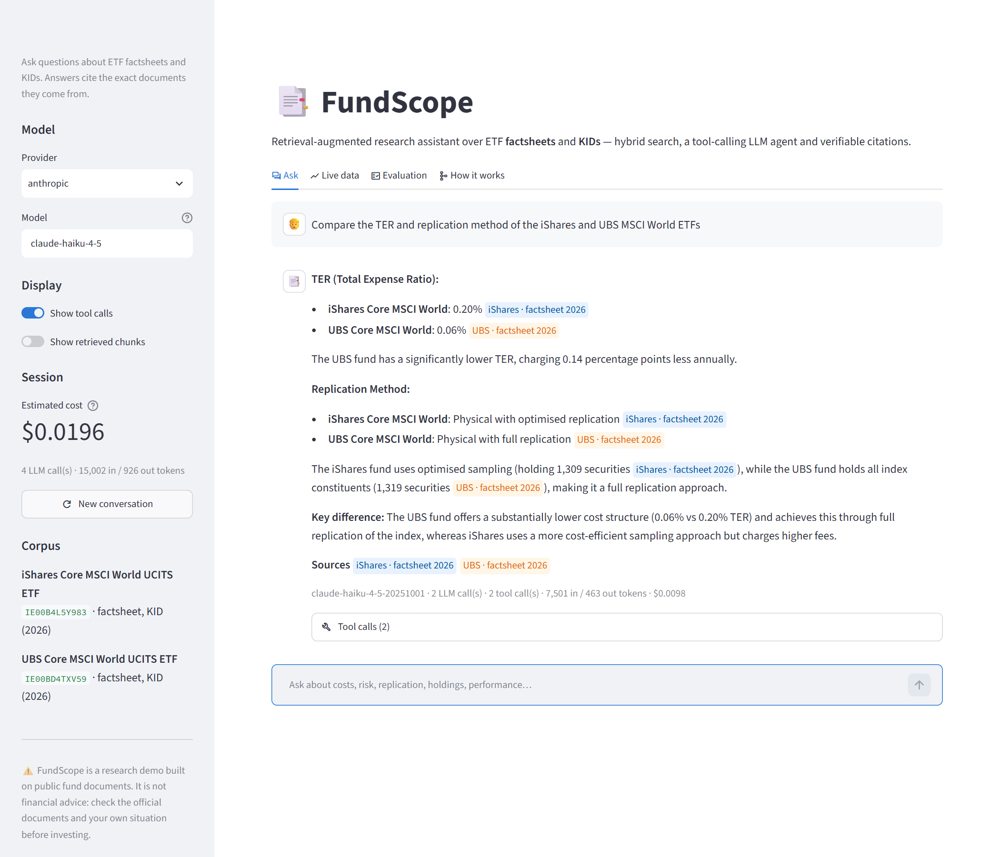
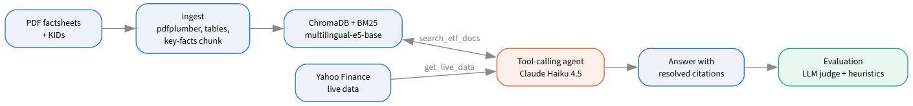

# FundScope — ETF Research Assistant (RAG)

A Retrieval-Augmented Generation system that answers plain-language questions about ETF factsheets and Key Information Documents (KIDs), citing the exact documents each answer comes from.

Built as a hands-on project to learn RAG end-to-end: PDF ingestion, hybrid search, a tool-calling LLM agent, verifiable citations and an LLM-judged evaluation.



---

## Architecture



- **Ingest** (`fundscope.ingest`): `pdfplumber` extracts text and tables, chunks them (tables kept whole) and adds a synthetic *key facts* chunk per document; every chunk carries ISIN, issuer, doc type, year and section.
- **Index** (`fundscope.embed`, `fundscope.retrieve`): `multilingual-e5-base` embeddings in a local ChromaDB, plus BM25; the two rankings are fused with RRF, with metadata filters and *single* / *comparative* / *cross-document* modes.
- **Agent** (`fundscope.agent`): the LLM chooses its tools (`search_etf_docs`, `get_live_data` from Yahoo Finance, `list_available_etfs`), searches again when results miss, and cites `[Chunk N]`; the code rewrites each tag with the chunk's real metadata.
- **LLM layer** (`fundscope.llm`): provider-neutral; Claude Haiku 4.5 via the Anthropic API by default, any OpenAI-compatible provider via `.env`.

Embeddings and retrieval run locally; only generation calls the LLM provider. Two alternative engines are kept for comparison: the older fixed pipeline (`--engine rag`) and full context, with every document in the cached prompt (`--engine full`).

---

## Setup

Requires Python 3.13 and [uv](https://docs.astral.sh/uv/).

```bash
uv sync                                    # creates .venv and installs the fundscope package
cp .env.example .env                       # then set ANTHROPIC_API_KEY=sk-ant-...
uv run python -m fundscope.llm.cli --ping  # checks the key (a fraction of a cent)
```

Put the PDFs in `data/raw/` and register each file in `src/fundscope/metadata.json`:

```json
{
  "iShares_Core_MSCI_World_UCITS_ETF_USD_acc_factsheet.pdf": {
    "isin": "IE00B4L5Y983",
    "name": "iShares Core MSCI World UCITS ETF",
    "issuer": "ishares",
    "category": "MSCI World",
    "type": "factsheet",
    "currency": "USD",
    "share_class": "acc",
    "year": 2026,
    "quarter": "Q4",
    "yahoo_ticker": "EUNL.DE"
  }
}
```

`name` and `yahoo_ticker` are fund-level: repeat them identically on every document of the same ISIN (`uv run python -m fundscope.registry` prints the resulting fund list). Issuers: `ishares`, `ubs`, `xtrackers`, `amundi`; types: `factsheet`, `kid`. Adding an ETF only takes new PDFs and their entries here.

Then build everything with one command:

```bash
uv run fundscope-setup                    # checks deps, PDFs and the LLM key, ingests, builds the index
uv run fundscope-setup --rebuild          # full rebuild (after changing chunking or the embedding model)
uv run fundscope-setup --skip_ingest      # data/processed/ already populated
uv run fundscope-setup --skip_llm_check   # no API call
```

Without a key, setup still builds the index and retrieval-only evaluation works.

### LLM configuration (`.env`)

| Variable | Default | Meaning |
|---|---|---|
| `LLM_PROVIDER` / `LLM_MODEL` | `anthropic` / `claude-haiku-4-5` | Generator; the model is required for providers other than anthropic |
| `JUDGE_PROVIDER` / `JUDGE_MODEL` / `JUDGE_EFFORT` | `anthropic` / `claude-sonnet-5-5` / `medium` | LLM judge used by the evaluation |
| `ANTHROPIC_API_KEY`, `GROQ_API_KEY`, `GEMINI_API_KEY`, `OPENROUTER_API_KEY` | — | Only the key of the provider in use is needed |
| `LLM_MAX_COST_USD` | `0.50` | Per-run budget: the run stops (keeping partial results) once reached |
| `LLM_MIN_INTERVAL_S` | `0` | Minimum seconds between LLM calls (free tiers) |
| `LIVE_DATA_TTL_S` | `3600` | Yahoo Finance cache lifetime in `data/cache/live_data/` (`0` disables) |

Precedence: `--provider` / `--model` flags > environment / `.env` > `src/fundscope/config.py`. Switching provider is a `.env` change, e.g. `LLM_PROVIDER=groq`, `LLM_MODEL=llama-3.3-70b-versatile`, `GROQ_API_KEY=...` (model names are examples; any tool-capable model works).

To add a provider: for an OpenAI-compatible API, add one line to `OPENAI_COMPAT_PROVIDERS` in `src/fundscope/llm/openai_compat.py` (the key is read from `<NAME>_API_KEY`); otherwise subclass `LLMClient` in `src/fundscope/llm/` and hook it into `get_llm()`. Prices go in `src/fundscope/llm/pricing.py` (models without a price report the cost as unknown).

**Never commit `.env`** — it is git-ignored.

---

## Usage

### Web UI

```bash
uv run fundscope                  # http://localhost:8501, opens the browser
uv run fundscope --port 8600 --no-browser
```

Four tabs: **Ask** (chat with the agent: citation badges, live tool calls, retrieved chunks, per-answer cost; provider and model switchable in the sidebar), **Live data** (price, returns and a 12-month chart from Yahoo Finance), **Evaluation** (reference runs side by side) and **How it works** (the diagram above and the design choices). The first question after a start waits ~10–30 s for the embedding model to load. The server listens on localhost only; stop it with Ctrl+C.

### Terminal

```bash
uv run fundscope-cli                                                   # interactive prompt
uv run fundscope-cli --query "What is the SRI of IE00B4L5Y983?" --show_cost
uv run fundscope-cli --query "Compare the replication methods of both ETFs" --show_chunks --show_calls
uv run fundscope-cli --provider groq --model llama-3.3-70b-versatile
```

```
  Ask> What is the TER of the iShares MSCI World ETF?

  The TER of the iShares Core MSCI World UCITS ETF is 0.20%
  [IE00B4L5Y983 | ishares | factsheet | 2026]

  Sources:
    • iShares Core MSCI World UCITS ETF (IE00B4L5Y983) | factsheet | 2026

  Ask> And the UBS one?
```

The last 5 questions and answers are remembered, so follow-ups work. Prompt commands: `funds` (list ETFs), `chunks` / `calls` (toggle retrieved chunks / tool calls), `reset` (forget the conversation), `help`, `exit`.

Every command accepts `-v` / `--verbose` (logs to stderr; stdout carries only the output).

---

## Evaluation and results

22 ground-truth questions (17 English, 5 Italian) in `evaluation/ground_truth.json`, scored by heuristics and an LLM judge:

```bash
uv run fundscope-pipeline --run_eval [--engine agent|rag|full] [--limit 3] [--qids T1_001 T2_003]
uv run python evaluation/evaluate.py --ground_truth evaluation/ground_truth.json \
    --pipeline_output evaluation/runs/<run>.json --report evaluation/report.json \
    --judge llm --compare evaluation/baseline_cloud.json
uv run python evaluation/run_retrieval.py   # retrieval only, no LLM (score with --retrieval_only)
```

All runs use Claude Haiku 4.5 as the generator and Claude Sonnet 5.5 as the judge. "Pass" is the judge verdict, "correct" its correctness score (partial = ½), "grounded" the share of answers whose claims are all supported by the retrieved context.

| Run | Engine | Questions | Pass | Correct | Grounded | Attribution | Retrieval P / R | Cost (run + judge) |
|---|---|---|---|---|---|---|---|---|
| `baseline_cloud.json` (phase 3) | fixed RAG | 17 EN | 35.3% | 46.7% | 82.4% | 0.88 | 0.99 / 1.00 | $0.03 + $0.09 |
| `report_phase4_agent.json` | agent | 17 EN | 70.6% | 83.3% | 76.5% | 0.82 | 0.85 / 0.94 | $0.21 + $0.13 |
| `report_phase5_agent.json` | agent | 22 (17 EN + 5 IT) | 68.2% | 92.5% | 72.7% | 0.91 | 0.78 / 0.96 | $0.15 + $0.20 |
| `report_phase5_full.json` | full context | 22 (17 EN + 5 IT) | 81.8% | 95.0% | 86.4% | 0.95 | 0.43 / 1.00 | $0.07 + $0.22 |

The agent fixed most of the baseline's failures (abstentions: the right document was retrieved but not the chunk holding the value). Its remaining misses are mostly on groundedness: Haiku adds explanations the documents do not contain. On this small corpus (~15k tokens) giving the model every document is both better and cheaper; retrieval should pay off as the corpus grows. Retrieval precision is lower for the agent and full context by design: they read more documents than a question strictly needs.

A typical answer costs ≈ $0.001–0.01. Each run file stores per-question tokens and cost; use `--limit` / `--qids` while developing.

---

## Development

```bash
uv run ruff check .
uv run pytest -q            # ~60 tests, ~2 min; no network, no API key
```

The tests never call an LLM or download a model: a hashing embedder builds a temporary ChromaDB index, the agent runs against a scripted `LLMClient`, and both provider backends are checked against canned SDK responses. CI (`.github/workflows/ci.yml`) runs ruff and pytest on every push; the retrieval-only gate runs only where `data/raw/` holds the (unversioned) corpus PDFs.

---

## Limitations

- The corpus covers two ETFs (iShares and UBS MSCI World); adding more needs their documents and `metadata.json` entries.
- Generation needs network access and an API key with credit; without them only retrieval works.
- Temporal queries (same ETF across years) need multi-year documents; their evaluation scaffolding (`_parked_type3` in `ground_truth.json`) is inactive until then.
- Embedding runs on CPU (~10–20 s for ~500 chunks); no GPU required.
